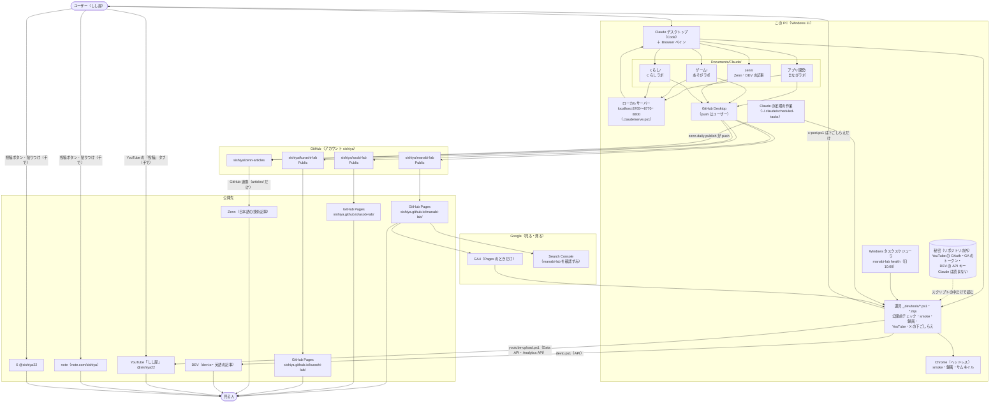
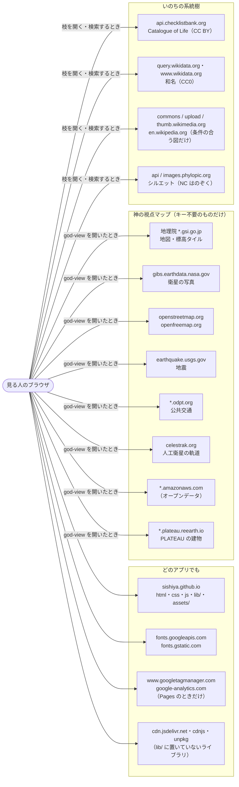

# しし屋の構成図（システム・ネットワーク・発信先）

2026-10-18 時点。作業の流れ（だれが何をいつ）は `_dev/WORKFLOW.md`、PC が壊れたときは `_dev/RECOVERY.md`。
ここは「何がどこにあって、どこからどこへつながっているか」と「記事をどこに何本書いたか」の地図。
**秘密（鍵・トークン）は名前だけ書き、置き場所は書かない。** 構成が変わったら（サービス・リポジトリ・定期の作業・記事の置き場所が増えた・減った）、ここも同じコミットで直す。

---

## 1. システム構成図（全体）

### リポジトリ

| フォルダ（Documents/Claude/） | GitHub | 公開先 | 中身 |
|---|---|---|---|
| `アプリ開発/` | `sishiya/manabi-lab`（Public） | https://sishiya.github.io/manabi-lab/ | まなびラボ（学習アプリ・入口・保管庫・道具・紹介動画の台本） |
| `ゲーム/` | `sishiya/asobi-lab`（Public） | https://sishiya.github.io/asobi-lab/ | あそびラボ（ゲームのほう。決まりは `ゲーム/RULES.md`） |
| `くらし/` | `sishiya/kurashi-lab`（Public） | https://sishiya.github.io/kurashi-lab/ | くらしラボ（仕事や生活に役立つツール。2026-10-19 に作った。方針は `くらし/CLAUDE.md`、案は `IDEAS.md` の「姉妹サイトのアイデア」。確認はまなびラボの launch.json の `kurashi`＝8800） |
| `しし屋/` | `sishiya/sishiya.github.io`（Public。2026-10-24 に作った） | https://sishiya.github.io/ | しし屋のトップ（3つのラボへの案内・robots.txt・ラボをまとめたサイトマップ。方針は `しし屋/CLAUDE.md`。確認は `しし屋/.claude/launch.json` の `top`＝8810） |
| `zenn/` | `sishiya/zenn-articles` | Zenn（`articles/`）・DEV（`dev/` を API で） | 技術記事。決まりは `zenn/README.md` |

- push はどれもユーザーがチャットで頼んだときだけ（`MANABI_PUSH_OK=1`）。例外は `zenn-daily-publish` の zenn の push だけ（2026-10-16 にユーザーが頼んだ）。
- まなびラボから移したアプリ（`resistance/`）は、旧 URL から `asobi-lab/resistance/` へ飛ぶ1ページだけ残す。

### 定期で動くもの

| 名前 | どこで | いつ | すること |
|---|---|---|---|
| `manabi-lab health` | Windows タスクスケジューラ（Claude を使わない） | 毎週日曜 10:00 | 一時サーバーで smoke（全アプリ）＋リンク切れ＋ `upkeep.mjs` → `_dev/tools/out/health-last.md`・`upkeep-last.md`。問題があればセッションのはじめのフックが知らせる |
| `manabi-lab-weekly-tidy` | Claude の定期の作業 | 毎週日曜 10:30 ごろ | 7日さわっていないセッションをアーカイブ（削除しない）、片づけの点検を短く報告 |
| `zenn-daily-publish` | Claude の定期の作業 | 毎朝 9:30 ごろ | Zenn の次の1本を `published: true` にして zenn を push |
| `manabi-playlist-sync` | Claude の定期の作業 | 20:00・20:05 の公開のあと | 説明動画とショートを YouTube の再生リスト2つに足す |
| `verify-youtube-2026-10-13`・`yt-captions-rest-1018` | Claude の定期の作業 | 1回きり（API の上限が戻ったあと） | YouTube の確認・翻訳字幕の残り。済んだら消してよい |

---

## 2. ネットワーク構成図（見る人のブラウザがどこにつながるか）

- **ここにない外への通信はしない**。この一覧は `_dev/tools/smoke.ps1` の `$allowCommon`・`$allowApp` と同じで、ほかの所へつないだら smoke が「許可していない外への通信」で NG にする（正はそちら。アプリにつなぎ先を足したら smoke と、ここを直す）。
- 出どころの論文・資料（doi.org・arxiv.org・pmc など）へは**リンクだけ**（見る人がクリックしたとき新しいタブで開く。自動ではつながない）。
- GA は `sishiya.github.io` で開いたときだけ読みこむ（ローカルでは送らない）。プライバシーポリシーは `privacy.html`。
- 開発中（ローカル）: Browser ペイン・ヘッドレスの Chrome → `localhost:8765〜8770`（`.claude/launch.json` の `apps`〜`apps-6`）、くらしラボは `kurashi`（8800）。並行するセッションがポートを分けて使う。
- 自分の PC から外へ出るのは、push（GitHub）・`youtube-upload.ps1`（YouTube Data API・YouTube Analytics API・GA4 Data API）・`devto.ps1`（DEV の API）・`check-links.mjs`（出どころのリンクを確かめる）・調べものだけ。

---

## 3. 発信先と記事の地図（あとで忘れないように）

### どこに何を書くか

| 発信先 | 何を | 下書きの置き場所 | 出し方 |
|---|---|---|---|
| **Zenn** | 技術の話（日本語）。Claude が書く | `zenn/articles/<slug>.md`（画像は `zenn/images/<slug>/`） | `published: true` → push。いまは `zenn-daily-publish` が1日1本（Zenn は24時間あたりの本数に上限がある） |
| **DEV（dev.to）** | Zenn の英語版 | `zenn/dev/<slug>.md`（記事の id は `zenn/dev/ids.json`） | `zenn/tools/devto.ps1 -Slug`（下書き）→ `-Publish`（GO のあと） |
| **note** | 作った理由・きっかけ（ユーザーの言葉だけ。Claude は思い出を足さない） | `_dev/promo/note/` | ユーザーが貼って投稿（公式の API がない） |
| **YouTube の動画** | ショート＝紹介、横長＝使い方 | 台本 `_dev/promo/<app>*.html`、説明欄 `*.upload.json`、予定 `_dev/promo/SCHEDULE.md` | `youtube-upload.ps1`（GO のあと） |
| **YouTube の「投稿」** | 動画の公開の知らせ | `_dev/promo/POSTS.md` | ユーザーが Studio に貼る（20:10） |
| **X** | ショートの紹介 | `x-post.ps1` が文を作る | ユーザーが投稿 |
| 記事のネタ | まだ文章にしていない材料 | `_dev/RETRO.md`（ふりかえり・ブログネタ）、`ゲーム/ARTICLES.md`（あそびラボのネタ帳） | — |

毎日やること（公開の日の手順）は `_dev/promo/DAILY.md`、導線の企画（A〜I）は `_dev/REACH.md`。

### Zenn・DEV の記事（2026-10-18 時点）

Zenn の順は YouTube の公開順。日付・状態の正は `zenn/README.md` の表と `_dev/promo/SCHEDULE.md`（ここは見取り図）。

| アプリ | slug | Zenn | DEV（英語） |
|---|---|---|---|
| ブラックホールの見え方 | `blackhole-kerr-raytracing-webgl2` | 公開 10/14 | 送った（id あり） |
| ヒトへの46億年 | `evolution-earth-box-model` | 公開 10/15 | 公開 |
| 体内ダイブ | `body-dive-tube-shader-junction` | 公開 10/16 | 公開 |
| いきものの感じる世界 | `animal-senses-shader-passes` | 公開 10/17 | 公開 |
| 量子の実験室 | `quantum-tunnel-visscher-canvas` | 公開 10/18 | 公開 |
| さなぎの中で | `metamorphosis-time-driven-canvas` | 10/19 朝の予定 | 公開 10/16 |
| 免疫のたたかい | `immune-ode-model-rk4` | 10/20 朝の予定 | 動画の日に |
| 空気の流れの見える部屋 | `airflow-age-of-air-bicgstab` | 10/21 朝の予定 | 動画の日に |
| 進化の箱庭 | `ga-creatures-spring-physics` | 10/22 朝の予定 | 動画の日に |
| 神の視点マップ | `godview-tear-earth-sph-worker` | 10/23 朝の予定 | 動画の日に |
| 電波の見える部屋 | `wifi-fdtd-webgl2-grid-fix` | 10/24 朝の予定 | 動画の日に |
| カビが育つまで | `mold-growth-hyphae-grid` | 10/25 朝の予定 | 動画の日に |
| 変化球のしくみ | `pitch-magnus-nathan-rk4` | 10/26 朝の予定 | 動画の日に |

### note

| # | 題（中身） | 下書き | 状態 |
|---|---|---|---|
| 01 | まなびラボ全体の話（作った理由） | `_dev/promo/note/01-manabi-lab.md` | 公開 2026-10-17 https://note.com/sishiya/n/nd0cc68388e15 |

### アカウント（名前だけ）

| サービス | アカウント |
|---|---|
| GitHub | sishiya |
| YouTube | 「しし屋」 @sishiya22 |
| X | @sishiya22 |
| note | note.com/sishiya |
| Zenn・DEV（プロフィール） | zenn.dev/sishiya・dev.to/sishiya |
| Zenn・DEV | `zenn-articles` のリポジトリから（Zenn は GitHub 連携） |
| Google | GA4（`G-E2VPYKV2Y9`）・Search Console・Google Cloud（YouTube・GA の API） |

名前はどれも「しし屋」にそろえる（2026-10-24 決定。ラボはその中のシリーズ。名前の変更はユーザーが手で: `_dev/sns-icon/brand-2026-10/TODO-user.md`）。YouTube の説明・英語・キーワード・バナーは `_dev/promo/channel.json` → `youtube-upload.ps1 -Channel`。

---

## 4. 秘密と鍵（名前と「どこが使うか」だけ）

| もの | 使うもの | 戻し方 |
|---|---|---|
| YouTube の OAuth クライアント・トークン | `youtube-upload.ps1` | `_dev/RECOVERY.md` |
| GA4 Data API のトークン | `youtube-upload.ps1 -Ga`・`popular.ps1`・`weekly-report.ps1` | 同上 |
| DEV の API キー | `zenn/tools/devto.ps1` | DEV の Settings → Extensions で作りなおす |
| 自分の語（公開前チェック用） | `check-public.ps1` | `_dev/RECOVERY.md` |

どれもリポジトリの外か `.gitignore` の中。Claude は中身を読まない・表示しない（`.claude/hooks/guard.pl` が止める）。
